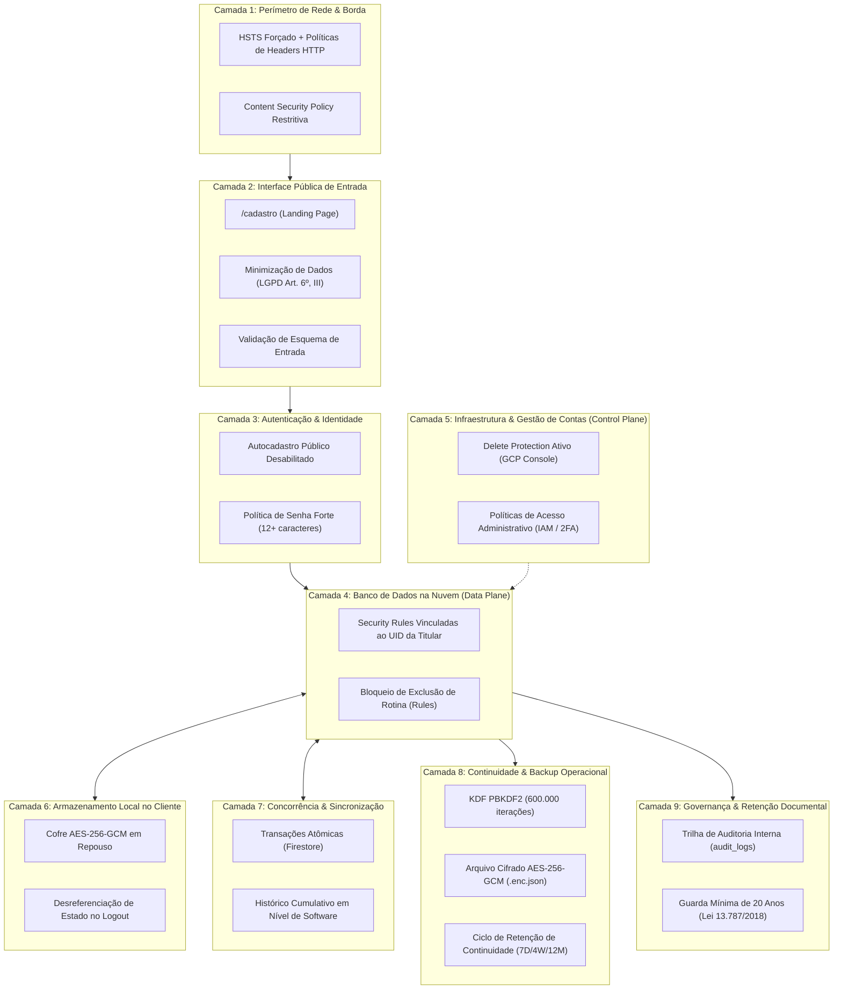

# Memorial Descritivo de Controles de Segurança da Informação, Modelagem de Riscos e Boas Práticas
**Sistema de Gestão Clínica Psicológica — Dra. Ana Lima (CRP 04/60205)**  
*Documento Unilateral de Engenharia de Software, Modelagem de Ameaças e Práticas de Governança de Dados*  
*Data de Revisão Técnica: 30 de Setembro de 2026*  
*Versão da Aplicação: v2.0.0*

---

## 1. Escopo, Natureza do Documento e Limites de Finalidade

Este memorial descritivo documenta a arquitetura, as medidas técnicas, organizacionais e os mecanismos criptográficos implementados no sistema clínico da **Dra. Ana Lima (CRP 04/60205)**. 

### Natureza do Documento
> [!IMPORTANT]
> **Declaração de Limite de Finalidade**: Este documento constitui um memorial técnico descritivo elaborado unilateralmente pela equipe de desenvolvimento e sustentação de software da aplicação. **Não representa laudo pericial forense, auditoria externa independente (tais como relatórios SOC 2, ISO/IEC 27001) nem certidão oficial de conformidade expedida por órgão regulador**.
> 
> Em segurança da informação, não existem sistemas invulneráveis. A finalidade deste memorial é relatar com transparência e sobriedade de engenharia:
> 1. Os controles mitigadores implementados no código-fonte, na camada de rede e no banco de dados em nuvem;
> 2. As limitações operacionais conhecidas e os riscos residuais aceitos em cada tecnologia;
> 3. As referências técnicas e normativas utilizadas para orientar o desenvolvimento (CFP, LGPD e diretrizes de boas práticas da indústria).

---

## 2. Diagrama de Arquitetura de Defesa em Profundidade

O sistema adota um modelo conceitual estruturado em **9 camadas independentes de controle**, combinando barreiras de perímetro, isolamento de dados, mecanismos criptográficos e rotinas de governança:



---

## 3. Memorial Detalhado dos Controles e Limitações Conhecidas

### Camada 1: Perímetro de Rede, Borda e Cabeçalhos HTTP
* **Controles Implementados** (`firebase.json`):
  * `Strict-Transport-Security: max-age=31556926; includeSubDomains; preload`: Força conexões HTTPS pelo navegador por 1 ano.
  * `Content-Security-Policy`: Restringe scripts e conexões estritamente a domínios indispensáveis (`apis.google.com`, `firestore.googleapis.com`, `identitytoolkit.googleapis.com`, fontes Google e Google Meet).
  * `X-Frame-Options: DENY`: Mitiga ataques de sequestro de clique (*clickjacking*).
  * `X-Content-Type-Options: nosniff`: Previne interpretação maliciosa de tipos MIME.
  * `Permissions-Policy: camera=(), microphone=(), geolocation=()`: Desativa permissões de periféricos de hardware na navegação geral.
* **Escopo e Limitações**: Mitiga ataques comuns de rede e adulteração em trânsito; não impede ameaças originadas em extensões maliciosas ou malwares instalados diretamente no dispositivo do usuário.

---

### Camada 2: Interface Pública de Entrada e Triagem
* **Controles Implementados** (`src/components/intake/PatientIntakeView.tsx` e `firestore.rules`):
  * **Minimização de Dados (LGPD Art. 6º, III)**: Campo de queixa inicial limitado a **300 caracteres**, acompanhado de instrução expressa de que detalhes aprofundados e histórico de saúde devem ser fornecidos exclusivamente durante a sessão clínica sob sigilo profissional.
  * **Validação de Esquema no Firestore**: A coleção `/public_intakes` aceita somente operações `create` anônimas cujos campos respeitem limites predefinidos (`name` entre 2 e 120 caracteres; `phone` entre 8 e 30 caracteres).
  * **Bloqueio de Leitura Externa**: Operações de `read`, `update` e `delete` são restritas exclusivamente ao perfil autenticado da titular.
* **Limitações e Riscos Residuais Declarados**:
  * **Ausência de Limitação de Taxa (*Rate Limiting*) e CAPTCHA**: O endpoint público priorizou a acessibilidade e o acolhimento sem atrito para o paciente, optando por não implementar desafios visuais (CAPTCHA) ou barreiras complexas de entrada.
  * **Risco Residual**: As validações de esquema impedem dados malformados, mas **não impedem envio automatizado de cadastros falsos em massa (*spam*)**. Esse risco é absorvido operacionalmente pela psicóloga na fila de triagem, sem afetar dados sensíveis de pacientes já cadastrados. Mecanismos como Firebase App Check ou reCAPTCHA Enterprise permanecem como alternativa de aprimoramento futuro.

---

### Camada 3: Autenticação e Controle de Sessão
* **Controles Implementados** (`src/components/auth/AuthModal.tsx` e `src/services/authService.ts`):
  * **Desativação de Autocadastro Público**: A interface foi restrita exclusivamente ao acesso por credenciais existentes; a rotina de auto-registro foi removida.
  * **Política de Senha Forte**: Validador no frontend que exige 12+ caracteres, contendo letras maiúsculas, minúsculas, números e caracteres especiais.
  * **Encerramento de Sessão (*Logout*)**: Limpa tokens transitórios de APIs parceiras (Google Agenda) e desreferencia a chave criptográfica em memória do dispositivo.
* **Escopo e Limitações**: Mitiga tentativas de acesso de curiosos via interface web. Depende da segurança da senha e do gerenciador de senhas sob custódia da profissional.

---

### Camada 4: Banco de Dados na Nuvem — Plano de Dados (*Data Plane*)
* **Controles Implementados** (`firestore.rules`):
  * **Restrição de Acesso por Identidade**:
    ```javascript
    function isAna() {
      return request.auth != null && request.auth.uid == '<UID_TITULAR_CLINICA>';
    }
    ```
  * Todas as subcoleções clínicas de pacientes e coleções de prontuários exigem que `isAna()` seja satisfeito.
  * **Bloqueio de Exclusão de Rotina**: Coleções clínicas (`/clinical_records`, `/anamnesis`) declaram `allow delete: if false;`.
* **Delimitação Fundamental de Escopo**:
  * As *Security Rules* do Firestore governam **exclusivamente as conexões originadas de clientes Web e Mobile** (SDKs clientes).
  * Elas **não interceptam chamadas administrativas de servidor** (Firebase Admin SDK ou Google Cloud IAM). A segurança da infraestrutura contra destruição ou vazamento administrativo pertence ao plano de controle (Camada 5).

---

### Camada 5: Infraestrutura e Gestão de Contas — Plano de Controle (*Control Plane*)
* **Controles Implementados** (Console do Google Cloud Platform):
  * **Proteção contra Exclusão de Banco de Dados**: A instância Firestore sob o projeto `<FIREBASE_PROJECT_ID>` possui proteção ativa contra exclusão (`DELETE_PROTECTION_ENABLED`), bloqueando comandos acidentais de destruição da base.
* **Riscos Residuais e Dependências Operacionais**:
  * A integridade de nível administrativo depende estritamente da higidez das credenciais Google com acesso de gestão (`<CONTA_ADMINISTRADORA_GCP>`).
  * **Medida mandatória**: Autenticação de dois fatores (2FA via app autenticador TOTP ou chave de segurança física) deve permanecer ativada em todas as contas associadas aos papéis `Owner`, `Editor` ou `Firebase Admin`.

---

### Camada 6: Armazenamento Local no Cliente (`localStorage`)
* **Controles Implementados** (`src/services/localVaultCrypto.ts` e `src/services/storageService.ts`):
  * **Criptografia Autenticada em Repouso**: Dados persistidos localmente recebem envelope cifrado em **AES-256-GCM** com vetor de inicialização (IV) de 12 bytes gerado criptograficamente para cada gravação.
  * **Cache em Memória de Leitura**: Consultas do aplicativo durante a sessão são atendidas a partir de estrutura em memória, evitando leituras em texto plano no disco.
  * **Purga de Chave no Logout**: Ao clicar em "Sair", a chave de sessão local é destruída do armazenamento e as variáveis de memória são desreferenciadas.
* **Delimitação Técnica e Riscos Conhecidos**:
  * **Vulnerabilidade a Ataques em Runtime (XSS)**: Se um ataque de Cross-Site Scripting obtiver execução no mesmo contexto da página, ele poderá acessar os dados em memória durante a sessão, independentemente da criptografia em disco. A Camada 6 visa mitigar primariamente o acesso estático desautorizado aos dados persistidos em disco (ex.: extração do `localStorage` via acesso físico à máquina).
  * **Limites de Memória RAM**: Motores JavaScript de navegadores comerciais (V8, WebKit) não garantem sobrescrita física imediata (*zeroing*) de registradores de RAM após a desreferenciação por coleta de lixo (*garbage collection*).

---

### Camada 7: Concorrência e Histórico de Revisões
* **Controles Implementados** (`src/services/cloudSyncService.ts`):
  * **Transações Atômicas**: Métodos de sincronização utilizam `runTransaction()` do Firestore.
  * **Controle de Versão**: Comparações entre `version` e `updatedAt` evitam que um dispositivo que operou offline sobrescreva alterações mais novas efetuadas em outro aparelho.
  * **Histórico Cumulativo em Nível de Software**: Edições em evoluções registram a versão anterior no array `history[]` da aplicação, acompanhado de data, hora e justificativa clínica (Resolução CFP 001/2009).
* **Limitações Declaradas**:
  * O histórico em `history[]` é um **registro cumulativo mantido pela lógica da aplicação cliente**. Não se trata de armazenamento físico WORM (*Write Once, Read Many*) nem de registro com assinatura assimétrica por hardware, podendo ser alterado por operações de nível administrativo no plano de controle.

---

### Camada 8: Continuidade Operacional e Backups Criptografados
* **Controles Implementados** (`src/services/backupCrypto.ts`, `src/services/backupService.ts`, `.github/workflows/daily-backup.yml`):
  * **Arquitetura Criptográfica do Arquivo `.enc.json`**:
    * **Derivação de Chave (KDF)**: A chave de 256 bits é gerada a partir da senha do usuário via **PBKDF2-HMAC-SHA256 utilizando 600.000 iterações** e sal aleatório de 16 bytes. Este parâmetro adota a recomendação mais conservadora das diretrizes da OWASP (*Password Storage Cheat Sheet*, contexto FIPS) para desacelerar substancialmente ataques de força bruta e dicionário por GPU.
    * **Cifra Simétrica**: Criptografia autenticada **AES-256-GCM** com vetor de inicialização (IV) de 12 bytes gerado via Web Crypto API e verificação de integridade via Authentication Tag de 128 bits.
    * **Checksum de Integridade**: Verificação determinística via hash **SHA-256** antes e depois do desempacotamento.
  * **Ciclo de Retenção de Continuidade**: Rotina diária via GitHub Actions com retenção escalonada (7 diários, 4 semanais, 12 mensais) voltada à recuperação de desastres operacionais de curto e médio prazo.
* **Riscos Residuais Declarados**:
  * **Dependência da Entropia da Senha**: A segurança do arquivo cifrado depende fundamentalmente da complexidade da senha definida pela psicóloga.
  * **Irrecuperabilidade Intencional**: A perda da senha impossibilita a recuperação dos dados arquivados no arquivo `.enc.json`.
  * **Diferenciação de Finalidade**: O ciclo de retenção dos backups (até 12 meses) destina-se à continuidade operacional e restauração contra falhas de sistema, não se confundindo com o prazo legal de 20 anos de custódia documental (detalhado na Camada 9).

---

### Camada 9: Governança, Rastreabilidade e Custódia Documental
* **Controles Implementados** (`src/services/auditService.ts` e `src/components/settings/SettingsView.tsx`):
  * **Logs de Aplicação para Governança Interna (LGPD Art. 37)**: Registro de eventos de visualização de prontuários (`view_record`), gravações (`save_record`), exportações de PDF (`export_record_pdf`) e backups.
  * **Preservação de Registros na Inativação de Pacientes**: Quando um paciente é inativado da lista de atendimentos ativos, seus prontuários e anamneses **permanecem preservados no banco de dados**, garantindo o cumprimento dos prazos regulatórios.
* **Harmonização dos Prazos de Retenção e Descarte**:
  * **Resolução CFP nº 001/2009 (Art. 2º)**: Determina a guarda obrigatória do prontuário psicológico por período **mínimo de 5 anos**.
  * **Lei Federal nº 13.787/2018 (Art. 6º)**: Estabelece que os prontuários eletrônicos de saúde **podem ser eliminados após o decurso do prazo mínimo de 20 anos**, contados a partir do último registro realizado. A lei estipula um piso temporal mínimo de custódia antes do qual o descarte é vedado; ela não impõe vedação perpétua de exclusão.
  * **Conciliação Técnica do Sistema**: O bloqueio de exclusão em nível de cliente (`allow delete: if false;` nas regras do Firestore) visa impedir o descarte acidental, indevido ou unilateral no dia a dia da clínica. Eventual expurgo legal após o decurso do prazo de 20 anos deverá ocorrer mediante procedimento formal fundamentado em parecer ético-jurídico, com intervenção administrativa controlada no plano de gestão (control plane), e não por meio de ação ordinária na interface clínica.
* **Delimitação sobre o Marco Civil da Internet**:
  * Os registros gerados em `audit_logs` são logs internos da lógica da aplicação voltados à governança da clínica. **Não se confundem com os registros de conexão e de acesso a aplicações de internet** de que trata o art. 15 da Lei nº 12.965/2014 e o Decreto nº 8.771/2016, cuja exigibilidade e parâmetros técnicos vinculam-se aos requisitos legais de provedores de aplicação.

---

## 4. Anonimização em Serviços Terceiros (Google Agenda)

* **Controle Implementado** (`src/services/calendarService.ts`):
  * A função `formatConfidentialPatientName()` mascara o nome do paciente antes da criação do evento no Google Calendar.
  * Exemplo de formato: `Sessão Psicoterapia — Mariana S. S.`
* **Objetivo de Mitigação**: Reduzir a superfície de exposição inadvertida de nomes completos de pacientes em notificações na tela de bloqueio de celulares, smartwatches ou telas compartilhadas (Código de Ética Profissional do Psicólogo, Art. 9º).

---

## 5. Registro de Testes Funcionais e Sanidade Interna

Os testes abaixo foram desenvolvidos e executados em ambiente de desenvolvimento local com validação pontual contra os serviços implantados em 30 de Setembro de 2026, servindo como verificação interna de sanidade das rotinas implementadas:

| Verificação | Script / Ferramenta | Cenário Avaliado | Resultado Observado |
| :--- | :--- | :--- | :--- |
| **Cofre Local (Storage)** | `scripts/test-local-vault.mjs` | Cifra de prontuário fictício, conferência de ausência de texto puro no storage e validação de decifração | **Aprovado**: Gravado sob envelope `_vault: true`; decifração íntegra; ausência de dados em texto plano. |
| **Restauração de Backup** | `scripts/test-restore.mjs` | Decifração com PBKDF2 (600k) / AES-GCM e teste negativo com senha incorreta | **Aprovado**: Decifrado com senha correta e checksum SHA-256 válido; rejeitado imediatamente via tag de autenticação GCM com senha incorreta. |
| **Regras de Acesso (Firestore)** | `scripts/verify-security.mjs` | Tentativas de leitura não autorizada em `/public_intakes`, `/patients` e `/users/{uid}/*` | **Aprovado**: Todas as tentativas retornaram `permission-denied` ou `auth/invalid-credential`. |
| **Checagem Estática de Tipagem** | `npx tsc --noEmit` | Verificação do compilador TypeScript | **0 erros de compilação**. |
| **Build de Produção** | `npm run build` | Empacotamento de assets via Vite | **Concluído com sucesso** sem alertas críticos. |
| **Headers HTTP de Borda** | `curl -s -I [URL Hospedagem]` | Verificação dos cabeçalhos na CDN do Firebase Hosting | **Confirmado**: HSTS (`max-age=31556926`), CSP, X-Frame-Options (`DENY`), X-Content-Type-Options (`nosniff`). |

---

## 6. Recomendações e Boas Práticas Operacionais para a Clínica

Para que os controles técnicos implementados mantenham sua efetividade no cotidiano profissional, recomenda-se a observância das seguintes práticas pela profissional:

1. **Gestão de Dispositivos e Credenciais**:
   - Manter autenticação em duas etapas (2FA via app autenticador) ativada na conta Google da profissional e nas contas com privilégios de sustentação da plataforma.
   - Utilizar bloqueio automático de tela com biometria ou senha forte em todos os dispositivos de trabalho (computador e smartphone).
2. **Ambientes Compartilhados**:
   - Em caso de acesso eventual a partir de computadores de terceiros, **efetuar obrigatoriamente o Logout ao término da utilização**, assegurando a desreferenciação da chave do cofre local e dos dados em memória.
   - Nunca salvar senhas no navegador de computadores de uso compartilhado.
3. **Custódia das Senhas de Backup**:
   - Armazenar a senha mestra dos backups `.enc.json` em local estritamente seguro e confidencial (como gerenciador de senhas com cofre mestre), ciente de que não existe procedimento de recuperação de senha esquecida.
4. **Governança Ético-Jurídica Contínua**:
   - Submeter as políticas de privacidade, termos de consentimento (TCLE) e rotinas de descarte periódico à validação contínua por assessoria jurídica especializada em direito médico e proteção de dados.
